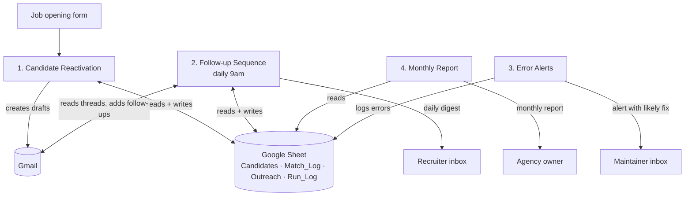
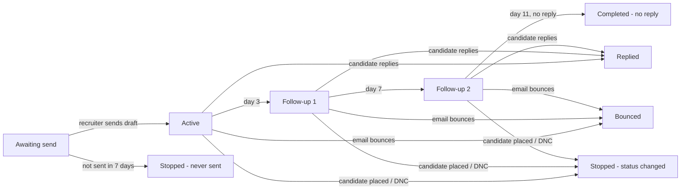

# AI Candidate Reactivation for Recruiting Agencies

An n8n automation system that turns a staffing agency's existing candidate database into new placements. When a new job opens, it finds the best-fitting past candidates, drafts a personal email to each one for the recruiter to approve, follows up automatically, detects replies and bounces, and sends the agency owner a monthly results report.

**Demo video:** _[add your video link here]_

---

## The problem

Staffing agencies hold thousands of past candidates who were already sourced, screened and paid for. When a new job comes in, recruiters usually start from scratch on job boards, because searching the database, checking who is off-limits, writing personal emails and chasing follow-ups by hand takes too long.

## What the system does

| # | Workflow | Trigger | What it does |
|---|---|---|---|
| 1 | **Candidate Reactivation** | Recruiter submits a job form | Filters out anyone who must not be contacted, scores the rest with AI (0–100 plus a reason), writes personal emails for the top matches as Gmail drafts, and logs every decision |
| 2 | **Follow-up Sequence** | Every morning at 9am | Reads each Gmail thread: detects sent emails, replies and bounces; writes follow-ups in the same thread; stops on reply; sends the recruiter a daily digest with replies first |
| 3 | **Error Alerts** | Any workflow fails | Emails the maintainer the failed step, the error and a likely fix, and logs it |
| 4 | **Monthly Client Report** | 1st of each month | Emails the agency owner: candidates reviewed, emails sent, replies, reply rate, follow-ups, estimated hours saved, who replied, and system health |

## Architecture



The Google Sheet stands in for the agency's ATS (applicant tracking system) so the system can be demonstrated without one. In production, the Candidates tab would be replaced by an ATS connection.

## Follow-up sequence logic



## Safety and compliance by design

- **Hard rules before any AI:** never contacts candidates marked Do Not Contact, Placed, Not Looking, Interviewing, Responded or Email bounced; 30-day cooldown between reactivation emails
- **Human in the loop:** first emails are always drafts a recruiter reviews and sends; follow-ups are drafts by default, with an optional auto-send mode
- **Fair scoring:** the AI never sees candidate names and is instructed to ignore protected characteristics; it scores only job-relevant factors
- **Audit trail:** every AI score and its reason is logged; every run and error is recorded
- **Any reply stops the sequence immediately;** a maximum of two short follow-ups, always in the same thread
- **Graceful failure:** unreadable AI output falls back to a safe template or a "review manually" flag instead of breaking the run

## Tech stack

- **n8n** (workflow orchestration, 63 nodes across 4 workflows)
- **JavaScript** (26 Code nodes: filtering, sequence state machine, report generation)
- **OpenAI API** via n8n LLM chain nodes (scoring and email writing, with retries)
- **Gmail API** (drafts, thread reading, in-thread follow-ups, sending)
- **Google Sheets API** (data store and logs)

## Repository structure

```
workflows/      n8n workflow files, ready to import
src/            the JavaScript from every Code node, for easy reading
sample-data/    demo database (30 candidates) and a 24-candidate scenario test set
docs/           setup guide and test plan
```

## Getting started

1. Upload `sample-data/demo_candidates.xlsx` to Google Drive and save it as a Google Sheet.
2. Import the four files in `workflows/` into n8n (Error Alerts first).
3. In each workflow's **Settings** node, paste your Google Sheet URL and set your email addresses.
4. Connect Google Sheets, Gmail and OpenAI credentials.
5. Link workflows 1, 2 and 4 to the Error Alerts workflow.

Full step-by-step instructions: [docs/SETUP.md](docs/SETUP.md)

## Testing

The system was tested with a structured scenario plan using a 24-candidate test set, where each test candidate triggers a different path: reply, no reply, placed mid-sequence, never-sent draft, bounce, automatic sending, plus candidates that must never be contacted and a rerun to confirm nobody is contacted twice. See [docs/TESTING.md](docs/TESTING.md).

## Results from the scenario test

| Check | Result |
|---|---|
| Excluded candidates (do-not-contact, interviewing, placed, bounced, recently contacted) skipped | 5 of 5 skipped |
| Unrelated profiles removed before AI scoring | 7 of 7 removed |
| Strong matches found and drafted | 6 of 6 |
| Sent emails detected and follow-ups created | Passed |
| Bounce detected | Passed |
| Candidate reply detected, sequence stopped, recruiter alerted first | Passed |
| Monthly report figures matched the run log | Passed |

All candidate data in this repository is fictional.

## Limitations and next steps

- Connect directly to an ATS (e.g. Bullhorn, Loxo, JobAdder) instead of a Google Sheet
- Track interviews and placements to report revenue attributable to reactivation
- Smarter pre-filtering (skill synonyms) before AI scoring
- Out-of-office auto-replies are currently treated as replies

## Author

**Saad Khan**: AI automation for recruiting and staffing agencies
_[LinkedIn link] · [email]_
